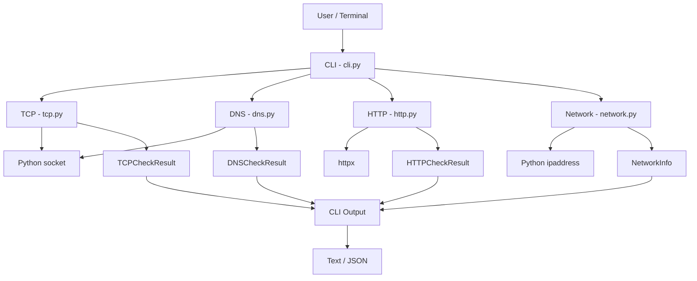
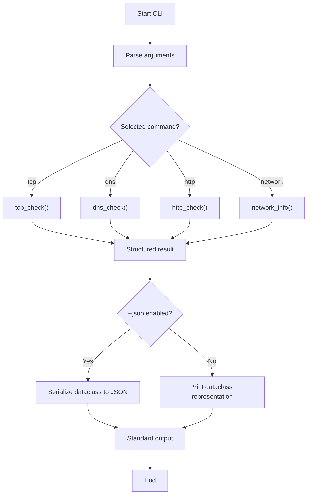

# Technical Specification — v0.1.0

**Project:** jc-sre-netprobe  
**Version:** 0.1.0  
**Status:** Released  
**Document type:** Retrospective Technical Specification

## 1. Overview

`jc-sre-netprobe` is a Python package designed to provide lightweight network health checks and IP networking utilities for Telecom, DevOps and Site Reliability Engineering (SRE) environments.

Version 0.1.0 establishes the initial modular architecture, exposing independent Python functions and a command-line interface (CLI).

## 2. Objectives

- Verify TCP endpoint connectivity.
- Resolve DNS hostnames to IPv4 and IPv6 addresses.
- Check HTTP/HTTPS endpoint availability.
- Calculate IPv4 and IPv6 network information.
- Expose structured results through Python dataclasses.
- Provide CLI execution with optional JSON output.

## 3. Architecture

The application follows a modular architecture with a centralized CLI and independent functional modules.



Each probe returns a structured result. The CLI selects the requested operation and formats its output.

## 4. Functional Components

### 4.1 TCP Connectivity

**Module:** `tcp.py`  
**Function:** `tcp_check(host, port, timeout=3.0)`

Establishes a TCP connection using `socket.create_connection()`.

**Behavior:**
- Measures successful connection latency with `time.perf_counter()`.
- Returns `reachable=True` when a connection is established.
- Returns `reachable=False` when an `OSError` occurs.
- Uses a default timeout of 3 seconds.

**Result:** `TCPCheckResult`

Fields: `host`, `port`, `reachable`, `latency_ms`, `error`.

### 4.2 DNS Resolution

**Module:** `dns.py`  
**Function:** `dns_check(hostname)`

Resolves hostnames using `socket.getaddrinfo()`.

**Behavior:**
- Retrieves IPv4 and IPv6 addresses when available.
- Removes duplicate addresses.
- Sorts the resulting address list.
- Captures `socket.gaierror` as a failed resolution.

**Result:** `DNSCheckResult`

Fields: `hostname`, `addresses`, `resolved`, `error`.

### 4.3 HTTP Health Check

**Module:** `http.py`  
**Function:** `http_check(url, timeout=5.0)`

Checks HTTP/HTTPS endpoint availability using `httpx.get()`.

**Behavior:**
- Follows HTTP redirects.
- Measures request latency.
- Considers status codes from 200 through 399 healthy.
- Captures `httpx.RequestError` as a failed request.
- Uses a default timeout of 5 seconds.

**Result:** `HTTPCheckResult`

Fields: `url`, `status_code`, `healthy`, `latency_ms`, `error`.

### 4.4 IP Network Information

**Module:** `network.py`  
**Function:** `network_info(cidr)`

Analyzes IPv4 and IPv6 networks using `ipaddress.ip_network(strict=False)`.

**Behavior:**
- Accepts IPv4 and IPv6 CIDR notation.
- Normalizes host addresses to their containing network.
- Calculates network address, prefix length and netmask.
- Provides IPv4 broadcast address.
- Calculates total addresses and IP version.
- Identifies whether the network is classified as private by Python's `ipaddress` implementation.

**Result:** `NetworkInfo`

Fields: `network`, `prefix_length`, `netmask`, `broadcast`, `total_addresses`, `ip_version`, `is_private`.

This component performs local calculations without network communication.

## 5. CLI Interface

**Module:** `cli.py`  
**Entry point:** `jc_sre_netprobe.cli:main`

Supported commands:

```bash
jc-sre-netprobe tcp github.com 443
jc-sre-netprobe dns github.com
jc-sre-netprobe http https://github.com
jc-sre-netprobe network 192.168.1.10/24
```

JSON output:

```bash
jc-sre-netprobe --json tcp github.com 443
```

The `--json` argument is a global option and must precede the subcommand.

The CLI uses `argparse` for argument parsing and `dataclasses.asdict()` with `json.dumps()` for JSON serialization.

## 6. Execution Flow



## 7. Error Handling

- TCP connection errors are captured as `OSError`.
- DNS resolution errors are captured as `socket.gaierror`.
- HTTP request errors are captured as `httpx.RequestError`.
- Invalid CIDR values may raise exceptions from `ipaddress`.
- CLI argument parsing errors are handled by `argparse`.

Version 0.1.0 does not implement dedicated operational exit codes. A probe returning an unhealthy result does not, by itself, cause the CLI to exit with a nonzero status.

## 8. Technology Stack

| Component | Technology |
|---|---|
| Language | Python >= 3.11 |
| CLI | argparse |
| TCP/DNS | socket |
| HTTP | httpx >= 0.27, < 1 |
| IP networking | ipaddress |
| Data structures | dataclasses |
| Testing | pytest |
| Static analysis | mypy (strict) |
| Linting | Ruff |
| Packaging | setuptools >= 77 |

## 9. Project Structure

```text
src/jc_sre_netprobe/
├── __init__.py
├── cli.py
├── tcp.py
├── dns.py
├── http.py
└── network.py

tests/
├── test_cli.py
├── test_tcp.py
├── test_dns.py
├── test_http.py
└── test_network.py
```

## 10. Testing and Quality

The repository includes test modules covering the CLI and the four functional modules.

The development configuration includes:

- pytest for automated testing.
- pytest-cov for coverage measurement.
- Ruff for linting.
- Mypy in strict mode for static type checking.
- Build and Twine for package distribution validation.

The existence of these tools and test modules is confirmed by the release metadata and repository structure. Specific historical test results and coverage percentages are not established by this document.

## 11. Known Limitations

- Only one operation is executed per CLI invocation.
- No configuration-driven bulk execution.
- No concurrent check execution.
- No TLS certificate inspection.
- No configurable timeout through the CLI.
- No operational exit-code contract for unhealthy checks.
- No persistent results or historical metrics.
- No continuous monitoring or alerting.

## 12. Version Evolution

Version 0.1.0 establishes the initial package architecture and functional baseline.

Subsequent releases can extend these capabilities while preserving the modular design and structured Python API.

---

**Source of truth:** Git tag `v0.1.0`.

**Documentation note:** This specification was written retrospectively from the published implementation. It describes observed behavior rather than pre-release requirements.
