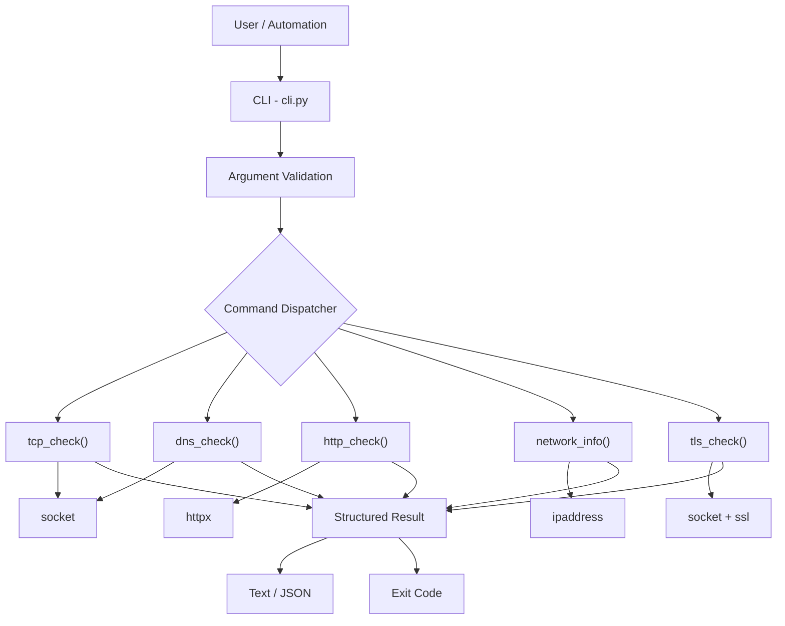
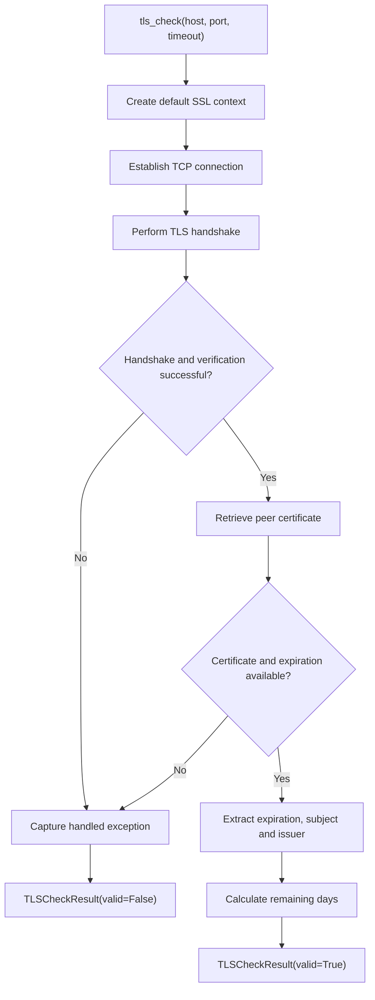
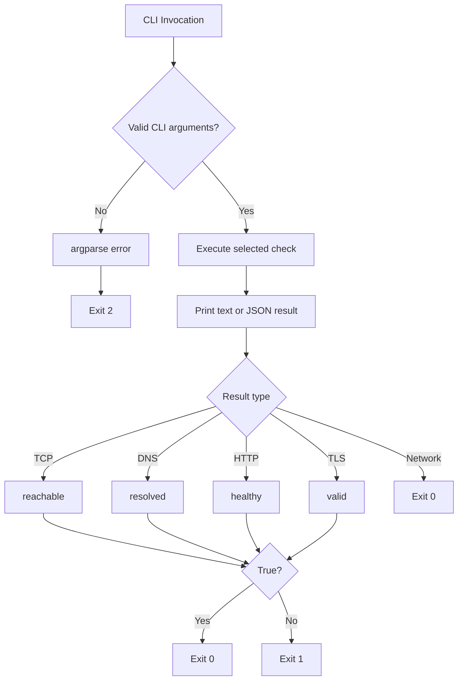

# Technical Specification — v0.2.0

**Project:** jc-sre-netprobe  
**Version:** 0.2.0  
**Status:** Released  
**Document type:** Retrospective Technical Specification  
**Previous version:** v0.1.0

## 1. Overview

Version 0.2.0 extends the initial `jc-sre-netprobe` architecture with TLS certificate validation, improved CLI argument validation, configurable timeouts and operational exit codes.

The release focuses on improving reliability, usability and integration with DevOps/SRE automation workflows.

## 2. Objectives

- Introduce TLS certificate verification.
- Support configurable TCP, HTTP and TLS timeouts through the CLI.
- Validate CLI arguments before executing probes.
- Return meaningful exit codes for operational checks.
- Preserve existing Python probe functions and commands.
- Extend automated test coverage.

## 3. Architecture

The application retains the modular design introduced in v0.1.0.



## 4. Functional Changes

### 4.1 TLS Certificate Verification

**Module:** `tls.py`  
**Function:** `tls_check(host, port=443, timeout=5.0)`

The TLS module establishes a TCP connection and performs a TLS handshake using Python's standard `ssl` library.

The implementation uses `ssl.create_default_context()` and passes the hostname through Server Name Indication (SNI).

The default SSL context verifies the certificate chain and hostname.

**Behavior:**

- Establishes a TCP connection.
- Performs a TLS handshake.
- Verifies certificate trust and hostname.
- Retrieves the peer certificate.
- Extracts the certificate expiration date.
- Calculates remaining validity days.
- Extracts certificate subject and issuer information.
- Returns a structured failure result for handled connection and TLS errors.

**Result:** `TLSCheckResult`

| Field | Type |
|---|---|
| `host` | `str` |
| `port` | `int` |
| `valid` | `bool` |
| `expires_at` | `str \| None` |
| `days_remaining` | `int \| None` |
| `issuer` | `str \| None` |
| `subject` | `str \| None` |
| `error` | `str \| None` |

The `expires_at` field uses an ISO 8601 representation with UTC timezone information.

The `days_remaining` value is calculated using the integer day component of the difference between expiration and current UTC time.

**Limitations:**

- No configurable certificate-expiration warning threshold.
- No custom CA bundle exposed through the public function.
- No certificate-chain details in the result.
- No certificate history or persistent monitoring.

### 4.2 TLS Execution Flow



## 5. CLI Improvements

**Module:** `cli.py`

Version 0.2.0 introduces explicit input validation and configurable timeouts.

### 5.1 Port Validation

**Function:** `valid_port(value)`

Accepted range:

```text
1–65535
```

Ports outside this range are rejected.

### 5.2 Timeout Validation

**Function:** `positive_timeout(value)`

Timeouts must be greater than zero.

The CLI exposes timeouts for TCP, HTTP and TLS operations.

### 5.3 CIDR Validation

**Function:** `valid_cidr(value)`

Uses `ipaddress.ip_network(strict=False)` to validate IPv4 and IPv6 network notation.

### 5.4 HTTP URL Validation

**Function:** `valid_http_url(value)`

Accepts URLs with HTTP or HTTPS schemes and a nonempty network location.

This validation does not constitute complete URL normalization or security validation.

## 6. CLI Commands

### TCP

```bash
jc-sre-netprobe tcp github.com 443 --timeout 3
```

### DNS

```bash
jc-sre-netprobe dns github.com
```

### HTTP

```bash
jc-sre-netprobe http https://github.com --timeout 5
```

### Network

```bash
jc-sre-netprobe network 192.168.1.10/24
```

### TLS

```bash
jc-sre-netprobe tls github.com --port 443 --timeout 5
```

### JSON Output

```bash
jc-sre-netprobe --json tls github.com
```

The global `--json` option remains available for every command.

## 7. Exit Codes

Version 0.2.0 introduces operational exit codes for command-line execution.

| Code | Meaning |
|---|---|
| `0` | Successful check or network information calculation |
| `1` | TCP, DNS, HTTP or TLS check returned an unhealthy result |
| `2` | CLI argument parsing or validation error handled by argparse |

The `network` command returns `0` after successful calculation.

Unhandled exceptions are not covered by this exit-code contract and may terminate execution with an error.

### 7.1 Exit Code Flow



## 8. CLI Entry Point

The package entry point changed from:

```toml
jc-sre-netprobe = "jc_sre_netprobe.cli:main"
```

To:

```toml
jc-sre-netprobe = "jc_sre_netprobe.cli:cli"
```

The implementation separates result calculation from process termination:

- `main() -> int`: executes the command and returns the exit code.
- `cli() -> None`: calls `main()` and terminates through `SystemExit`.

This supports direct testing of CLI return codes.

## 9. Compatibility

The release preserves the existing probe functions:

- `tcp_check()`
- `dns_check()`
- `http_check()`
- `network_info()`

The existing CLI commands remain available.

Version 0.2.0 adds the TLS functionality without changing the implementations of the original four probe modules.

## 10. Technology Stack

| Component | Technology |
|---|---|
| Language | Python >= 3.11 |
| TCP/DNS | socket |
| HTTP | httpx >= 0.27, < 1 |
| TLS | ssl |
| IP networking | ipaddress |
| CLI | argparse |
| Serialization | json, dataclasses |
| Testing | pytest, pytest-cov |
| Static analysis | mypy (strict) |
| Linting | Ruff |
| Packaging | setuptools >= 77 |

## 11. Project Structure

```text
src/jc_sre_netprobe/
├── __init__.py
├── cli.py
├── tcp.py
├── dns.py
├── http.py
├── network.py
└── tls.py

tests/
├── test_cli.py
├── test_tcp.py
├── test_dns.py
├── test_http.py
├── test_network.py
└── test_tls.py
```

## 12. Testing and Quality

The release includes changes to `tests/test_cli.py` and introduces `tests/test_tls.py`.

The test suite should verify:

- Successful TLS verification.
- Handled TLS and connection failures.
- Certificate metadata extraction.
- Port and timeout validation.
- HTTP URL and CIDR validation.
- CLI output serialization.
- Operational exit codes.
- Compatibility with existing commands.

These are documented verification objectives. Exact historical test coverage and individual test assertions require inspection of the corresponding test files.

## 13. Known Limitations

- No bulk execution of checks.
- No YAML-based configuration.
- No concurrent probe execution.
- No aggregated health summary.
- No configurable TLS-expiration thresholds.
- No historical result storage.
- No Prometheus metrics endpoint.
- No scheduled monitoring or alerting.

## 14. Version Evolution

Version 0.2.0 extends the original package with TLS verification and more predictable CLI behavior.

These improvements establish a foundation for configuration-driven bulk execution, concurrency and aggregated results in v0.3.0.

---

**Source of truth:** Git tag `v0.2.0`.

**Documentation note:** This specification was written retrospectively from the released source code. It documents implemented behavior and identifies verification objectives without claiming unverified historical test results.
