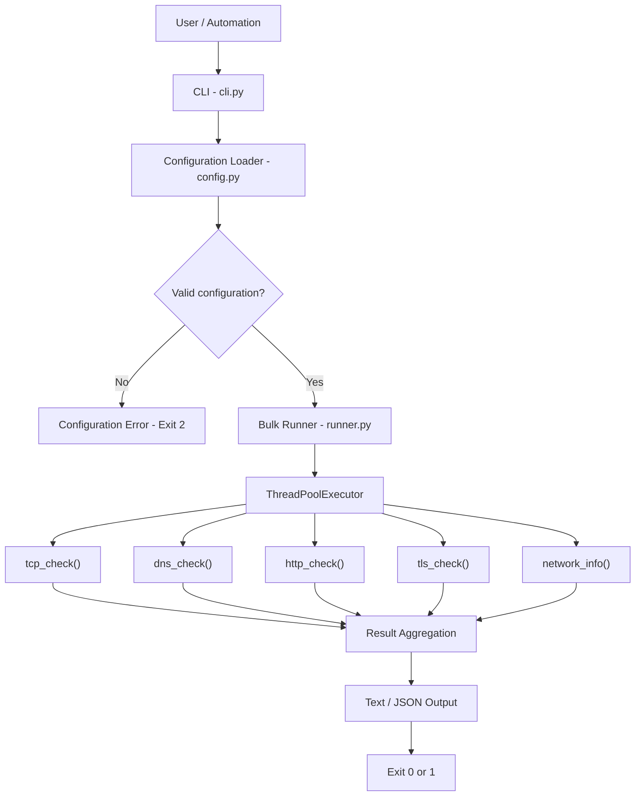
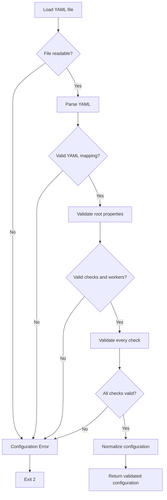
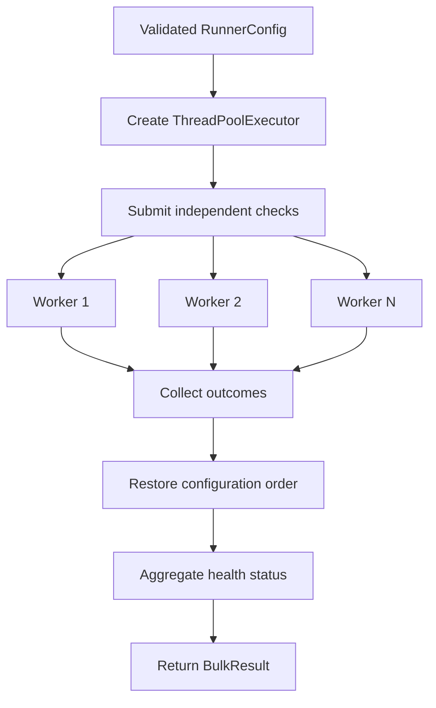

# Technical Specification — v0.3.0

**Project:** jc-sre-netprobe  
**Version:** 0.3.0  
**Status:** Planned  
**Document type:** Technical Design Specification  
**Previous version:** v0.2.0

## 1. Overview

Version 0.3.0 introduces configuration-driven bulk execution of network and service checks.

The release extends `jc-sre-netprobe` with a YAML configuration layer, concurrent execution, aggregated results and a new CLI command.

The objective is to support repeatable network diagnostics and service health verification in Telecom, DevOps and Site Reliability Engineering environments.

## 2. Objectives

- Define multiple checks through YAML.
- Validate configurations before execution.
- Reuse the existing TCP, DNS, HTTP, TLS and Network functions.
- Execute independent checks concurrently.
- Control concurrency through a configurable worker limit.
- Preserve the configuration order in the results.
- Isolate individual execution failures.
- Provide structured aggregated results.
- Support human-readable and JSON output.
- Preserve existing Python APIs and CLI commands.

## 3. Scope

### Included

- YAML configuration loading and validation.
- Bulk execution of TCP, DNS, HTTP, TLS and Network checks.
- Thread-based concurrency.
- Configurable worker count.
- Aggregated health summaries.
- CLI `run` command.
- JSON serialization.
- Aggregated exit codes.
- Unit and integration tests.

### Excluded

- Continuous monitoring.
- Scheduling.
- Persistent storage.
- Prometheus exporters.
- SLI/SLO calculations.
- Alerting.
- Dashboards.
- AsyncIO-based execution.
- Distributed execution.

## 4. System Architecture

The architecture introduces two modules:

- `config.py`: configuration loading, validation and normalization.
- `runner.py`: concurrent execution and result aggregation.

Existing probe modules remain responsible for their respective operations.



The configuration layer must complete validation before the runner starts executing checks.

## 5. Configuration Format

Configuration files use YAML.

Example:

```yaml
max_workers: 5

checks:
  - name: gateway-tcp
    type: tcp
    host: 192.168.1.1
    port: 443
    timeout: 3

  - name: public-dns
    type: dns
    host: example.com

  - name: website-http
    type: http
    url: https://example.com
    timeout: 5

  - name: website-tls
    type: tls
    host: example.com
    port: 443
    timeout: 5

  - name: subnet-info
    type: network
    cidr: 192.168.1.0/24
```

### 5.1 Root Properties

| Property | Type | Required | Default |
|---|---|---|---|
| `checks` | list | Yes | None |
| `max_workers` | integer | No | 5 |

`checks` must contain at least one entry.

`max_workers` must be a positive integer, excluding boolean values.

### 5.2 Check Properties

Every check must contain:

- `name`: unique nonempty string.
- `type`: supported check type.

Names must be unique within the configuration.

Unknown configuration properties are rejected to prevent silent configuration mistakes.

## 6. Supported Check Types

### 6.1 TCP

Required:

- `name`
- `type: tcp`
- `host`
- `port`

Optional:

- `timeout`, default `3.0`.

Port range: 1–65535.

### 6.2 DNS

Required:

- `name`
- `type: dns`
- `host`

No configurable DNS timeout is introduced in this release.

### 6.3 HTTP

Required:

- `name`
- `type: http`
- `url`

Optional:

- `timeout`, default `5.0`.

Only HTTP and HTTPS URLs with a nonempty network location are accepted.

### 6.4 TLS

Required:

- `name`
- `type: tls`
- `host`

Optional:

- `port`, default `443`.
- `timeout`, default `5.0`.

The existing TLS certificate verification behavior is preserved.

### 6.5 Network

Required:

- `name`
- `type: network`
- `cidr`

Both IPv4 and IPv6 CIDR notation are supported.

Network checks perform local calculations and are considered healthy when they complete successfully.

## 7. Configuration Validation

**Module:** `config.py`

Validation must occur before any probe execution.

Validation requirements:

1. The file must exist and be readable.
2. YAML syntax must be valid.
3. The root must be a mapping.
4. `checks` must be a nonempty list.
5. Every check must be a mapping.
6. Check names must be nonempty and unique.
7. Check types must be supported.
8. Required fields must be present.
9. Unknown fields must be rejected.
10. Ports must be valid integers in the accepted range.
11. Timeouts must be finite positive numbers, excluding booleans.
12. HTTP URLs must use HTTP or HTTPS.
13. CIDR values must be valid IPv4 or IPv6 networks.
14. `max_workers` must be a positive integer, excluding booleans.

Duplicate YAML mapping keys must be rejected rather than silently overwritten.

A configuration containing any invalid check must be rejected entirely.

No valid checks may execute when configuration validation fails.

### 7.1 Configuration Flow



## 8. Configuration Model

The configuration layer should expose typed models representing validated input.

Proposed models:

- `CheckConfig`
- `RunnerConfig`

`CheckConfig` represents one normalized check definition.

`RunnerConfig` contains:

- An ordered collection of validated checks.
- The maximum worker count.

The models should be immutable where practical.

Configuration validation errors should use a dedicated exception, such as `ConfigError`.

The CLI translates configuration errors into exit code `2`.

## 9. Bulk Runner

**Module:** `runner.py`

The runner receives validated configuration and dispatches checks to the existing probe functions.

Responsibilities:

- Select the correct probe.
- Execute independent checks.
- Capture individual execution failures.
- Preserve result ordering.
- Aggregate health status.
- Return structured execution results.

The runner must not duplicate the underlying network-check logic.

## 10. Concurrency

Execution uses:

```python
concurrent.futures.ThreadPoolExecutor
```

Default worker count:

```text
5
```

The worker count is configurable through `max_workers`.

The effective number of workers must not exceed the number of configured checks.

Concurrency is limited to independent checks. No ordering dependency between checks is supported.

The runner must preserve the original configuration order when presenting results, even when execution finishes in a different order.

### 10.1 Concurrent Execution Flow



## 11. Result Model

The runner must expose structured results.

### 11.1 Individual Result

Proposed model: `CheckExecutionResult`.

Fields:

| Field | Type | Description |
|---|---|---|
| `name` | string | Configured check name |
| `type` | string | Check type |
| `healthy` | boolean | Normalized health status |
| `result` | object or null | Underlying probe result |
| `error` | string or null | Unexpected execution error |

Handled probe failures remain represented by their existing dataclass results.

Unexpected runner-level exceptions are captured in `error` and mark the individual check unhealthy.

### 11.2 Aggregated Result

Proposed model: `BulkResult`.

Fields:

| Field | Type |
|---|---|
| `total` | integer |
| `healthy` | integer |
| `failed` | integer |
| `results` | list |

The following invariant must always hold:

```text
total = healthy + failed
```

## 12. Health Mapping

| Check type | Healthy condition |
|---|---|
| TCP | `reachable is True` |
| DNS | `resolved is True` |
| HTTP | `healthy is True` |
| TLS | `valid is True` |
| Network | Successful calculation |

Unexpected execution exceptions always produce an unhealthy result.

## 13. CLI Interface

The existing CLI commands remain available.

New command:

```bash
jc-sre-netprobe run checks.yaml
```

JSON output:

```bash
jc-sre-netprobe --json run checks.yaml
```

The `--json` flag remains a global argument.

The `run` command must use the configuration loader and bulk runner rather than directly implementing probe logic.

## 14. Human-Readable Output

Example:

```text
NAME           TYPE      STATUS   LATENCY
gateway-tcp    TCP       OK       12.4 ms
public-dns     DNS       OK       -
website-http   HTTP      OK       180.5 ms
website-tls    TLS       OK       -
subnet-info    NETWORK   OK       -

Summary: 5 checks | 5 healthy | 0 failed
```

Latency values are taken from the underlying probe result when available.

The CLI must not invent latency measurements for DNS, TLS or Network checks.

## 15. JSON Output

Example:

```json
{
  "total": 2,
  "healthy": 1,
  "failed": 1,
  "results": [
    {
      "name": "gateway-tcp",
      "type": "tcp",
      "healthy": true,
      "result": {
        "host": "192.168.1.1",
        "port": 443,
        "reachable": true,
        "latency_ms": 12.4,
        "error": null
      },
      "error": null
    },
    {
      "name": "website-http",
      "type": "http",
      "healthy": false,
      "result": {
        "url": "https://example.com",
        "status_code": 503,
        "healthy": false,
        "latency_ms": 180.5,
        "error": null
      },
      "error": null
    }
  ]
}
```

The example illustrates the output schema and is not a claim of actual probe results.

JSON output must remain machine-readable and contain no decorative terminal text.

## 16. Exit Codes

| Exit code | Condition |
|---|---|
| `0` | All checks healthy |
| `1` | One or more checks unhealthy |
| `2` | Invalid CLI usage or configuration |

File loading errors and invalid YAML must result in exit code `2`.

Unexpected failures isolated within individual checks must contribute to exit code `1`.

Errors should be reported through standard error where appropriate, without contaminating valid JSON output.

## 17. Error Isolation

A failure in one check must not interrupt other valid checks.

Examples:

- TCP connection refused.
- DNS resolution failure.
- HTTP timeout.
- Invalid TLS certificate.
- Unexpected probe exception.

Handled operational failures are returned through the existing probe result objects.

Unexpected exceptions are captured by the runner and represented as failed individual checks.

## 18. Dependencies

The existing `httpx` dependency is preserved.

New runtime dependency:

```text
PyYAML
```

Concurrency uses Python's standard library.

No additional execution framework is required.

## 19. Proposed Project Structure

```text
src/jc_sre_netprobe/
├── __init__.py
├── cli.py
├── config.py
├── dns.py
├── http.py
├── network.py
├── runner.py
├── tcp.py
└── tls.py

tests/
├── test_cli.py
├── test_config.py
├── test_dns.py
├── test_http.py
├── test_network.py
├── test_runner.py
├── test_tcp.py
└── test_tls.py

docs/
├── specification-v0.1.0.md
├── specification-v0.2.0.md
└── specification-v0.3.0.md
```

## 20. Testing Strategy

Tests must be deterministic and should not depend on external network availability.

### Configuration Tests

- Valid YAML configuration.
- Missing or unreadable file.
- Invalid YAML syntax.
- Duplicate YAML keys.
- Invalid root structure.
- Missing or empty checks.
- Duplicate check names.
- Unsupported check types.
- Missing required fields.
- Unknown fields.
- Invalid ports.
- Invalid timeouts.
- Invalid URLs.
- Invalid CIDR notation.
- Invalid worker count.

### Runner Tests

- Single check execution.
- Multiple check execution.
- Correct probe dispatch.
- Healthy result mapping.
- Partial failure handling.
- Unexpected exception isolation.
- Result ordering.
- Aggregated counters.
- Worker count behavior.

### CLI Tests

- Successful bulk execution.
- Partial failure.
- Invalid configuration.
- JSON output.
- Text output.
- Exit codes.
- Compatibility with existing commands.

## 21. Quality Gates

The implementation must pass:

```bash
ruff check .
mypy src tests
pytest -v
pytest --cov=jc_sre_netprobe --cov-report=term-missing
python -m build
twine check dist/*
```

GitHub Actions must continue validating supported Python versions.

## 22. Acceptance Criteria

Version 0.3.0 is considered complete when:

1. YAML configurations are loaded and validated.
2. Invalid configurations fail before execution.
3. All five check types are supported.
4. Checks execute concurrently with bounded workers.
5. Results preserve configuration order.
6. Individual failures do not interrupt other checks.
7. Aggregated counters are correct.
8. CLI text and JSON outputs work correctly.
9. Exit codes follow the documented contract.
10. Existing v0.2.0 functionality remains compatible.
11. Automated tests and quality gates pass.
12. Documentation and changelog are updated.

## 23. Implementation Phases

### Phase 1 — Configuration

- Add PyYAML dependency.
- Implement `config.py`.
- Add configuration models.
- Implement YAML validation.
- Add `test_config.py`.

### Phase 2 — Bulk Runner

- Implement `runner.py`.
- Add concurrent execution.
- Normalize health results.
- Aggregate results.
- Add `test_runner.py`.

### Phase 3 — CLI Integration

- Add `run` command.
- Add text and JSON output.
- Implement aggregated exit codes.
- Extend CLI tests.

### Phase 4 — Release Preparation

- Update README.
- Update CHANGELOG.
- Execute quality gates.
- Validate package build.
- Prepare release branch.
- Publish v0.3.0.

---

**Source of truth:** This specification defines the planned behavior of v0.3.0.

**Documentation note:** Unlike the v0.1.0 and v0.2.0 specifications, this document is written before implementation. Any architectural changes made during development must be reflected in the specification before release.